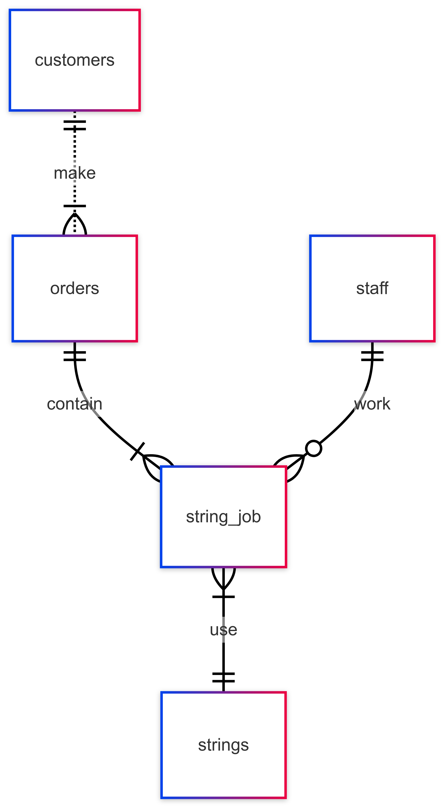

# 🏸 Smash Lab Database


**Smash Lab** is a SQLite database for a badminton racket-restringing shop. It tracks customers, staff, strings, orders and individual stringing jobs, from racket drop-off through to contactless locker pickup.

> **Result:** indexes on the shop's most-filtered columns cut the seven everyday queries from **5.6 s to 31 ms** (about 180× faster) on a test dataset of 90,000 stringing jobs. See [benchmark results](benchmark/RESULTS.md).

## 📌 Overview

A customer drops off one or more rackets, which creates an **order**. Each racket in that order is a **string job**, done by one **staff** member using one **string** from the shop's catalog. When every job in an order is done, the order moves to a locker, and the customer collects it with a locker number and password.



## 🗂️ Project Structure

```
.
├── sql/
│   ├── schema.sql        # tables, constraints and indexes
│   ├── seed.sql          # sample customers, staff, strings, orders and jobs
│   └── queries.sql       # the shop's seven everyday queries
├── benchmark/
│   ├── bench.py          # times the queries with and without indexes
│   └── RESULTS.md        # benchmark output
└── docs/
    ├── DESIGN.md         # design document: scope, entities, optimizations, limitations
    └── images/
        └── er-diagram.png
```

## 🚀 Quick Start

SQLite comes preinstalled on macOS and most Linux systems. From the repo root:

```bash
sqlite3 smashlab.db < sql/schema.sql
sqlite3 smashlab.db < sql/seed.sql
sqlite3 -box smashlab.db < sql/queries.sql
```

To browse the tables in a GUI, open `smashlab.db` in [DB Browser for SQLite](https://sqlitebrowser.org/).

## 📊 Core Entities

| Entity        | Description                                             |
|---------------|---------------------------------------------------------|
| `customers`   | Customer details such as name, contact number and signup date. |
| `staff`       | Employees who carry out the stringing jobs.             |
| `strings`     | Catalog of string types, specifications and prices.     |
| `orders`      | A customer's drop-off, containing one or more string jobs, with its locker and collection status. |
| `string_job`  | One racket's stringing job: string, colour, tension, cost and status. |

## ⚡ Indexes and Performance

Three indexes cover the columns the everyday queries filter on:

| Index | Speeds up |
|---|---|
| `string_job(order_id)` | Looking up an order's jobs, totals and cost breakdown |
| `string_job(job_status)` | The pending job queue |
| `orders(collection_status)` | Locker status checks and finding orders ready for collection |

Benchmark on synthetic data (50,000 orders, 90,034 string jobs), median time per query:

| Query | No indexes | With indexes |
|---|---:|---:|
| Orders ready for collection | 5,532 ms | 0.74 ms |
| Job specs for an order | 4.8 ms | 0.011 ms |
| Pending job queue | 7.0 ms | 0.80 ms |
| **All seven queries** | **5,585 ms** | **31 ms** |

Rerun it with `python3 benchmark/bench.py` (standard library only, takes a few minutes). It rewrites [`benchmark/RESULTS.md`](benchmark/RESULTS.md), which also has results at two other dataset sizes and the query plans.

## ✅ Key Features

- Constraints for data integrity: tension limited to 22–34 lbs, allowed values for statuses and string colours, unique contact numbers
- Default statuses for new jobs (`Pending`) and orders (`In-Store`)
- Contactless pickup through locker number and password
- Order totals calculated from their jobs rather than stored twice

## 📝 Design Notes

The full design document, covering scope, functional requirements, each entity's columns, and known limitations, is in [`docs/DESIGN.md`](docs/DESIGN.md).

## 🛠 Tech Stack

- **Database:** SQLite
- **Benchmark:** Python 3 (standard library)
- **Tools:** DB Browser for SQLite, VS Code
